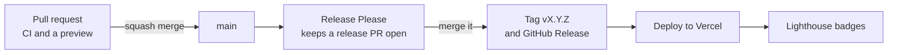

# Contributing

This is a personal site, so contributions are not expected, but the setup is documented here for anyone curious and for future me.

## Setup

Requires Node 24 (pinned in `.nvmrc`) and pnpm 12.14.0 (pinned in `package.json`'s `packageManager`; `corepack enable` picks it up).

```bash
pnpm install
pnpm dev        # http://localhost:3000
```

## Scripts

```bash
pnpm build         # production build, prerenders every route into .output/
pnpm build:vercel  # the same build with Vercel's output, into .vercel/output/
pnpm preview       # serve the production build
pnpm serve:prod    # serve the Vercel build as Vercel does, on :4173
pnpm test          # vitest run (jsdom, Testing Library)
pnpm test:e2e      # Playwright smoke tests against pnpm serve:prod
pnpm lighthouse    # Lighthouse CI budgets against pnpm serve:prod
pnpm typecheck     # tsc --noEmit
pnpm lint          # oxlint
pnpm lint:fix      # oxlint --fix
pnpm format        # oxfmt
pnpm format:check  # oxfmt --check
```

Run `pnpm lint && pnpm format:check && pnpm typecheck && pnpm test && pnpm build` before committing; CI runs the same five checks on every push to `main` and every pull request. The build runs the prerender crawl, which catches broken routes and loaders. Tests sit next to the code they cover as `*.test.ts` or `*.test.tsx`; component tests render the whole desktop through `src/test/desktop.tsx`.

The end-to-end tests and Lighthouse need the Vercel build: `pnpm build:vercel`, then `pnpm test:e2e` or `pnpm lighthouse`. Both start `scripts/serve-prod.mjs`, which follows the routes in `.vercel/output/config.json`, so pages get production's headers, statuses and compression, unknown URLs included. The Playwright tests live in `e2e/` and fail on any console error or CSP violation; `e2e/contrast.spec.ts` also runs axe's WCAG AA colour-contrast rule over every window, the menu bar, the dock and the open menu in every theme, since Lighthouse only sees the default one; run `pnpm exec playwright install --only-shell chromium` once first. Lighthouse runs the mobile preset three times on the home page and the 404 page, against the budgets in `lighthouserc.json` (performance at least 0.95, accessibility, best practices and SEO all 1, LCP under 2.5 s, CLS under 0.1, TBT under 200 ms). The 404 is checked audit by audit for SEO instead, skipping the indexing check, since it is `noindex` on purpose (the end-to-end tests check that it is). It uses your installed Chrome and writes its reports to `.lighthouseci/`. CI runs both as their own jobs; the Lighthouse reports are uploaded as an artifact.

Renovate opens dependency updates weekly. TanStack packages are pinned exactly and move together.

## Layout

- `src/routes/` file-based routes: the home page, which sets `head()` only. The root route renders `<Desktop>` (menu bar, dock, open windows) and the head for unknown URLs.
- `src/components/` desktop chrome: `Desktop`, `MenuBar`, `Clock`, `Dock`, `DockIcon`, `Window`, `WindowManager` and `ShutDown`, plus `Backdrop`, which lazy-loads the current theme's desktop background (`CodeRain`, `Drift`, `Orbits`, `Film` or `Streaks`).
- `src/components/apps/` window contents, one component per app, registered in `apps/index.tsx`.
- `src/lib/windows.ts` window ids and the windows open on first paint. The desktop has one URL; windows are state in `WindowManager`, and any other URL opens File Not Found.
- `src/lib/site.ts` all copy and project data, including the descriptions and headings of the home page and the 404.
- `src/lib/seo.ts` the head tags a page sets: title, description, canonical URL and link preview.
- `src/lib/security-headers.ts` and `src/lib/content-security-policy.ts` the headers every response gets, applied through Nitro route rules in `vite.config.ts`.
- `src/lib/theme.ts` the theme list (Orbital, the default, White Rabbit, Believe, Steamboat, OUTATIME and Outpost 31) and the inline script that applies the saved theme before first paint.
- `src/lib/terminal.ts` the Terminal app's commands.
- `src/styles.css` design tokens per theme, and the retro desktop chrome utilities.
- `public/fonts/` self-hosted fonts.
- `scripts/` Python scripts that build the menu marks, dock icons and Shut Down photo; see `scripts/README.md`.

## Workflow

Until v1.0.0, commits go straight to `main`. From v1.0.0, every change lands on `main` through a pull request, squash merged, so each PR becomes one commit and its title becomes the commit message. The description says what changed and how it was verified. History stays linear: rebase on `main`, never merge it into a branch.

## Commits

Conventional Commits with a required scope: `type(scope): subject`. From v1.0.0, with squash merges, this applies to PR titles.

- Types: `feat`, `fix`, `refactor`, `style`, `perf`, `docs`, `chore`, `build`, `ci`, `test`.
- Scopes: `app`, `desktop`, `theme`, `content`, `deps`, `config`. A `docs` commit takes the scope of what it documents, e.g. `docs(theme)`, never `docs(docs)`.
- Subject imperative, lowercase, no trailing period, under 72 characters.
- Themes are homages: describe what a change looks like, never name the film, show or site behind it.
- No AI attribution trailers (`Co-Authored-By: Claude`, "Generated with"). `Co-Authored-By` is a human-collaborator convention; AI tooling is a tool like a linter, not an author. The README already says the site is built with Claude Code.

## Releases and deploys

Production deploys only from tagged releases. Vercel's own Git deploys are off for `main` (`vercel.json`); pull requests still get preview deploys.



1. Every change lands on `main` as a squash-merged pull request with a Conventional Commit title.
2. Release Please (`.github/workflows/release.yml`) keeps a release PR open that bumps the version and writes `CHANGELOG.md` from those titles: `feat` is a minor release, `fix` and `perf` a patch.
3. Merging the release PR tags the version and creates a GitHub Release. The same workflow then builds with the Vercel CLI and deploys to production.
4. After each deploy, and weekly, `.github/workflows/lighthouse-badges.yml` runs Lighthouse against the live site and publishes the README badges to an orphan `badges` branch, so badge updates never touch `main`.

Nothing runs at request time, so the site itself needs no environment variables. The workflows need three repository secrets: `VERCEL_TOKEN`, `VERCEL_ORG_ID` and `VERCEL_PROJECT_ID`.

### Launching v1.0.0

The history before 1.0.0 is the build-up, so the first release is written by hand and Release Please starts after it:

1. Create the Vercel project, point `tompiarulli.com` at it, and add the three secrets.
2. Fill in the date of the 1.0.0 entry in `CHANGELOG.md`.
3. Tag the launch commit `v1.0.0` and create a GitHub Release from that entry. Release Please finds its last release by that tag (the manifest already says `1.0.0`), so it only reads commits after it.
4. Turn on the `main` ruleset: pull requests only, CI required, linear history, no force pushes, squash merges.
5. Uncomment the live link and badges at the top of the README.

See [CLAUDE.md](CLAUDE.md) for the conventions that apply to code and design.
