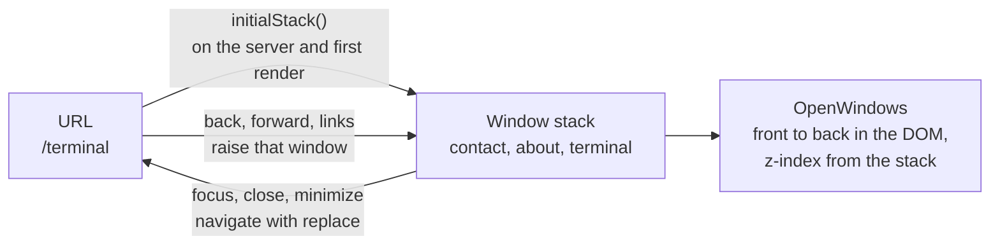

# Tom Piarulli

<!-- TODO(live link): uncomment once the site is deployed.
**[tompiarulli.com](https://tompiarulli.com)**
-->

<!-- TODO(badges): uncomment once CI is public and the Lighthouse job publishes badges.

Lighthouse performance, accessibility, best practices and SEO badges go here.
-->

My personal portfolio, styled as a late-90s desktop OS and inspired by [Poolsuite](https://poolsuite.net). It has draggable windows, a dock, a menu bar, a terminal, and six homage themes. Every page is prerendered to static HTML, so it loads instantly.

## Features

- **Themes:** six homages, each with its own colours, font, 16x16 menu mark and animated backdrop. Every theme but the default also sets the clock to a date that matters to whatever it nods to. Pick one in Settings or from the terminal; the choice is saved and applied before first paint.
- **Window manager:** drag windows by the title bar, double-click it to roll the window up like a windowshade, and click the focused window's dock icon to minimize it into the dock. Windows stack, raise when pressed, and stay mounted (scroll position included) while hidden. The URL follows the focused window, so back, forward and shared links open the right one.
- **Terminal:** a small shell with `ls`, `cat`, `open`, `theme`, `neofetch` and friends, command history on the arrow keys, and Tab completion. It also has easter eggs.
- **Shut Down:** the system menu shuts the desktop down: the chrome folds away, the picture tube switches off, and there is grass to touch to start it up again.
- **Mobile:** the same desktop on phones and tablets, with bigger title bars and close boxes for touch, windows that fit the screen, and no double-tap zoom.
- **Accessibility:** every window is a labelled landmark, and the whole desktop works from the keyboard: arrow keys move a window by its title, Enter rolls it up, Escape closes it, and focus moves on to the next window as on a desktop OS. The system menu follows the ARIA menu pattern, the terminal's output is a live log, theme colours meet WCAG AA contrast, and reduced motion stills the backdrops and turns off the animations.

## Tech Stack

- **App:** [TanStack Start](https://tanstack.com/start) (React 19, TanStack Router, file-based routing) on Vite and [Nitro](https://nitro.build), with every route prerendered. React, React DOM, Router and Start are the only runtime dependencies.
- **UI:** Tailwind CSS 4 over per-theme CSS custom properties. Backdrops are hand-written 2D canvas and raw WebGL; no icon packs, animation or state libraries.
- **Quality:** strict TypeScript, Vitest and Testing Library, oxlint and oxfmt.
- **Delivery:** GitHub Actions runs lint, format, typecheck, tests and the production build on every push and pull request. Renovate keeps dependencies current, and the build targets Vercel.
- **Assets:** Python scripts (Pillow) draw the menu marks, convert the dock icons and encode the Shut Down photo; see [`scripts/`](scripts/README.md).
- **Development:** [Claude Code](https://claude.com/claude-code), with its project instructions in [`CLAUDE.md`](CLAUDE.md).

## Architecture

Routes only set the URL and the page's `<head>`. The root route renders one `<Desktop>`: the menu bar, the dock, a lazy-loaded backdrop, and the open windows, all driven by a `WindowManager` that keeps a stack of window ids, back to front.

- **The URL follows the focused window.** Each window has a path ([`src/lib/windows.ts`](src/lib/windows.ts)). Focusing, closing or minimizing a window replaces the URL with the new top window's, and a URL change from back, forward or a link raises its window. About and Contact are always open; the URL's window comes to the front.
- **Each route prerenders with its window open.** The stack starts from `initialStack(pathname)`, which needs nothing but the path, so the server renders the same windows the browser hydrates. The prerender crawls every link, plus `/system` (only reachable from a closed menu) and `/404`, written as `404.html` and served for any unknown URL.
- **No theme flash.** Themes are CSS custom properties under `[data-theme]` in [`src/styles.css`](src/styles.css). An inline script in `<head>` ([`src/lib/theme.ts`](src/lib/theme.ts)) reads the saved theme from `localStorage` and sets `data-theme` before first paint. Anything that can't be known on the server (the saved theme, the time) renders a stable placeholder and fills in after hydration.
- **Lazy backdrops and windows.** Each backdrop (code rain, drifting glyphs, light streaks, orbital rings, a projector's flicker) is its own chunk, fetched after hydration and only for the current theme. They pause in background tabs and draw a single still frame under reduced motion, and the two heaviest cap their frame rate (24 and 30 fps). Terminal, Settings and System Info are chunks too, prefetched once the page is idle; About, Contact and File Not Found ship in the main bundle because every page opens with them.
- **Security headers through Nitro route rules.** [`vite.config.ts`](vite.config.ts) applies a `/**` route rule built in [`src/lib/security-headers.ts`](src/lib/security-headers.ts): a Content Security Policy that loads nothing from other origins and forbids framing, plus `nosniff`, a referrer policy and a permissions policy. A small Nitro module patches the routes Nitro writes for Vercel so these headers stack with the cache headers on static files, and unknown URLs get `404.html` from the CDN instead of reaching a function.

## Performance

Nothing runs at request time: every page is static HTML on Vercel's CDN.

<!-- TODO(lighthouse): once the Lighthouse CI job lands on main, add its budgets here
(the scores and Core Web Vitals each page must meet, and the throttling profile), and
how to run it locally. -->

**What keeps it fast:**

- **Prerendered HTML.** Each route's page already has its windows open and in place, so the first paint is the finished desktop. The home page is about 3.5 kB gzipped.
- **A small shell.** The main JavaScript chunk is about 118 kB gzipped and everything lazy adds about 13 kB more (measured from `pnpm build`, October 2026). Each backdrop is 1 to 1.6 kB gzipped.
- **Fonts.** Self-hosted WOFF2 files, subset to the characters the site uses (10 to 33 kB each). The default theme's two weights are preloaded with the stylesheet; every other theme's font is only fetched when that theme is on. All use `font-display: swap`.
- **Images.** The Shut Down photo is AVIF with WebP and JPEG fallbacks at four widths, and only loads when the desktop is shut down. Dock icons are 32x32 PNG masks tinted by CSS, and the menu marks are inline SVG.
- **Caching.** Hashed assets are cached immutably for a year; fonts, icons and images for a week.

## Credits

- Inspired by [Poolsuite](https://poolsuite.net).
- Fonts and their licences: [`public/fonts/README.md`](public/fonts/README.md).
- Dock icons and menu marks: [`public/icons/README.md`](public/icons/README.md).
- Shut Down photo by [Bruno Aguirre](https://unsplash.com/photos/green-field-YRfaG3JVwkU) on Unsplash.

## Contributing

See [CONTRIBUTING.md](CONTRIBUTING.md) for setup, scripts and guidelines.

## License

The code is [MIT](LICENSE). The fonts (SIL Open Font License 1.1), the dock icons (LGPL v2 or later) and the Shut Down photo (Unsplash License) keep their own licences; see the credits above.
